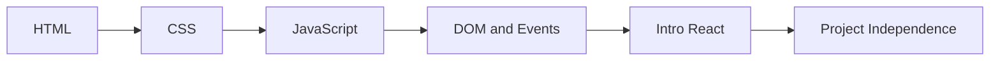
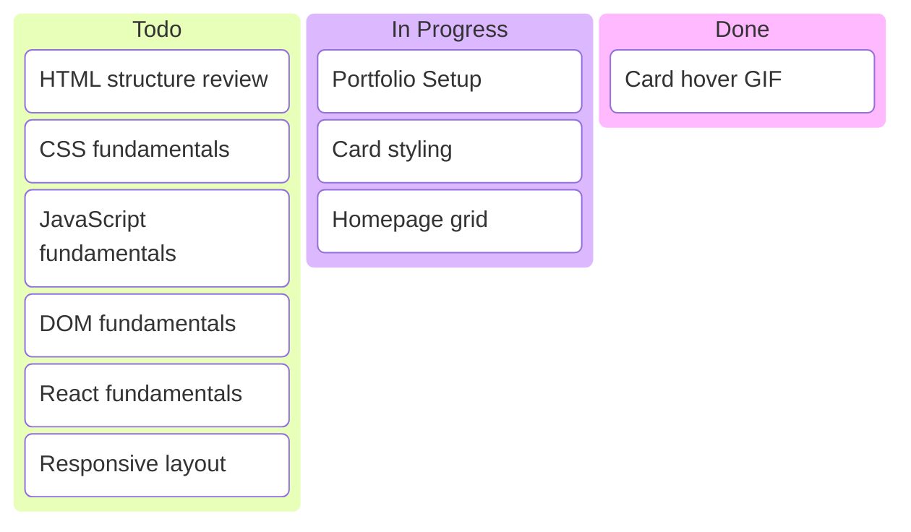
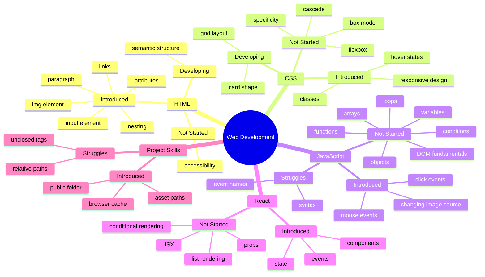

# Web Development Learning Progress

## Learning Path



---

## Project Kanban



---

## Knowledge Mind Map



---

## Current Focus

Main goal:

> Build the portfolio while learning the fundamentals behind each feature.

Current priority:

```text
HTML structure
→ CSS fundamentals
→ JavaScript fundamentals
→ DOM and events
→ React fundamentals
```

---

## Evidence Log

Use this section only for meaningful demonstrations of understanding.

Examples:

```text
- Responsive grid: Student fixed reversed columns to grid-cols-2 with lg:grid-cols-5 after one hint.
- Contact input: Student added full-width input with placeholder independently.
- Server secret: Student explained token stays on server.
- React state: Student added useState with value and onChange plus Send button.
- CSS width: Student explained w-full correctly.
```

Do not log ordinary questions.

Do not log explanations given by the instructor.

---

## Cheat Sheet & Syntax Notes

A Cheat Sheet entry means the concept was encountered.

It does not mean the concept is mastered.

### HTML

- **Paragraph:** `<p>Text</p>`
- **Image:** ``
- **Link:** `<a href="https://example.com">Link</a>`
- **Class:** `class="card"`

### CSS

- **Class selector:** `.card { }`
- **Padding:** `padding: 1rem;`
- **Margin:** `margin: 1rem;`
- **Grid:** `display: grid;`
- **Grid columns:** `grid-template-columns: repeat(3, 1fr);`
- **Hover:** `.card:hover { }`

### JavaScript

- **Variable:** `const name = "Sam";`
- **Condition:** `if (condition) { }`
- **Function:** `function greet() { }`
- **DOM selection:** `document.querySelector(".card")`
- **Event listener:** `element.addEventListener("click", handler)`

### React

- **Component:** `function Greeting() { return <p>Hello</p>; }`
- **JSX value:** `<p>{name}</p>`
- **Prop:** `function Greeting({ name }) { }`
- **State:** `const [count, setCount] = useState(0);`

---

## Mastery Rules

Do not mark a concept as `Mastered` because the student:

- asked about it;
- saw it;
- copied it;
- followed instructions;
- got one answer correct.

Mark `Mastered` only after repeated independent evidence.

Required evidence:

```text
Explain
+
Use independently
+
Apply in a new situation
+
Debug a simple mistake
+
Repeat successfully
```

If evidence is unclear, keep the concept in `Introduced` or `Developing`.
